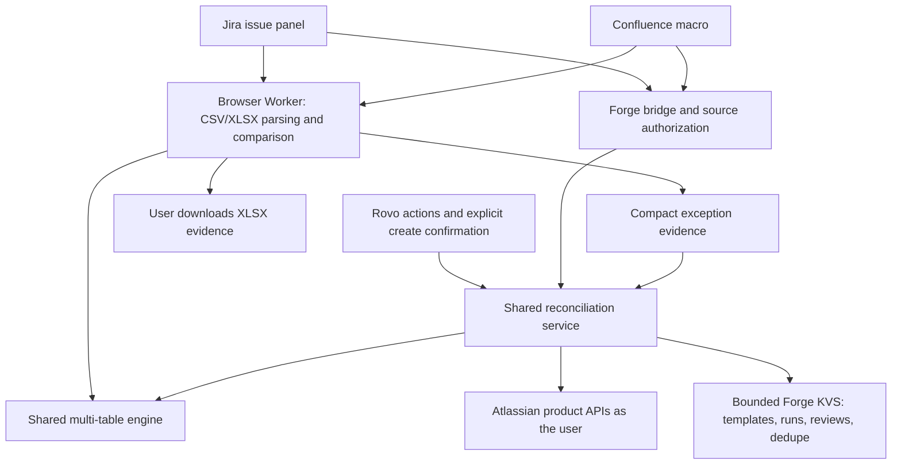

# Reconcile v4.1.6 for Jira & Confluence

Compare two to five attached CSV/XLSX exports, investigate differences and turn selected exceptions into Jira work. Reconcile runs on Atlassian Forge with a Jira issue panel, a Confluence macro and the Reconciliation Assistant in Rovo.

Judges install Reconcile through the production sharing link in [JUDGE-INSTALL.md](JUDGE-INSTALL.md). This repository contains application package **4.1.6**; the panel header reads **ATLASSIAN FORGE · v4.1.6**. Forge major/deployment numbers and the application package version are independent. 4.1.6 was deployed to production on 2026-11-11 (production major 3, both existing installations Up-to-date) after the full local and headless Edge UI regression passed. The brand-new Atlassian account and site check (installing through this link with no extra consent page or error, the three-table sample returning 3 / 1 / 2 / 2 / 0) was recorded for 4.1.3 on 2026-11-11 and has not been repeated for 4.1.6. This repository is MIT licensed.

## Features

- Two to five tables, any reference table, composite keys, worksheet selection and CSV header detection across title/preamble rows, including Chinese headers. UTF-8 and GBK/GB18030 are detected automatically; domestic exports may contain quoted thousands separators, ¥/￥/元 amounts, accounting negatives, Chinese/slash dates and full-width characters.
- Independent numeric tolerances, accepted date formats and text normalization per comparison field. Rule passes are shown with the results.
- Optional split-payment aggregation plus bounded amount combinations for one payment against several invoices or one invoice against several payments. Component keys, row numbers and integer-cent values remain visible in the UI and XLSX evidence.
- Matched, mismatched, incomplete-reference, missing-reference and duplicate categories, search/filter/pagination, and explicit acceptance of possible near matches.
- Evidence-based Explained/Ignored reviews and notes. Unchanged evidence survives saved-template reload; changed evidence invalidates prior reviews.
- Reconciliation statements and XLSX export, including detailed results and optional coloured worksheets preserving original data-column and row order.
- Project/space templates, recent run history and checkbox-selected Jira issue creation, either individual or grouped, behind a separate confirmation step.
- Rovo actions for saved-template runs, explanations of stored exceptions and confirmation-gated grouped issue creation with serial retry reuse.

## What has actually been verified

All cloud acceptance data was synthetic. The source test suite passes **136/136** tests, plus **6/6** Confluence/Rovo adapter tests. Local tests cover two through five tables, rule boundaries, parsing, workbook output, authorization and changed-evidence invalidation. Five-table coverage is local, rather than a live five-table acceptance claim. Phase 14 also passed the desktop/mobile headless UI regression, including the new explicit mapping confirmation.

The published demo video is v14: **3:28** (208.5 seconds), 1920×1080 at 30 fps, at https://youtu.be/dBggPDcc7wk. Its new scenes are production 4.1.6 captures (panel header v4.1.6, automatic A/B/C source selection, confirmed mapping and the 3 / 1 / 2 / 2 / 0 counts, the saved template name in a new Confluence report, the browser-refresh restored result, and a grouped issue with a readable description); they are real screenshots shown as short zoomed montages, not continuous interaction footage. Other scenes are kept from v13 (earlier live development captures), and every scene carries an on-screen source label. The Rovo segment replays existing recorded conversations read-only; no new Rovo action was run for the recording. The brief "Identifying attachments…" message was observed in production but is not shown. Decode, freeze, silence and clipping checks passed.

## Run locally

Use Node **24.22.1** (the locked Forge CLI requires `^22.23.4 || ^24.22.1 || >=26.12.1`).

```powershell
cd app
npm ci
npm test
npm run test:adapter
npm run test:d1 # with preview running
npm run build
npm run preview
```

Open `http://127.0.0.1:4178/?three-tables`. The preview explicitly says **LOCAL PREVIEW · SYNTHETIC DATA**. Only mock mode replaces the Forge bridge, using the shared service/engine and local browser storage; production builds use the real bridge. Local mock issue IDs are synthetic. No Atlassian account is needed for preview.

Choose `ledger.csv` as A, `bank.xlsx` as B and add `invoices.csv` as C; load the sources. Check B's automatically selected **Transactions** worksheet, enable **Ignore leading zeros in keys** and **Aggregate C**, click **Confirm column mapping**, then run. Expected counts are **3 / 1 / 2 / 2 / 0**. The judge files and exact settings are in [examples/three-tables](examples/three-tables) and the synthetic [examples](examples) package, including the 5.01 residual and domestic encodings. The root [samples](samples) folder retains the original 300-row two-table fixtures (270 / 18 / 10 / 10 / 1).

With preview running, `npm run test:ui` runs a headless Edge check at desktop/mobile widths, including real Worker parsing, worksheet/template reload, reviews, export and local uploads. It requires an installed Microsoft Edge browser. Outputs go to ignored `app/logs/`. `npm run check:manifest` validates the local manifest; authenticated Forge lint is `npm run lint:forge`. `npm run licenses` regenerates notices and enforces the existing license allowlist. The optional historical comparison requires your separately supplied engine through `RECONCILE_REFERENCE_FILE`; that private reference is not included.

## Install your own deployment

For the existing shared production app, follow [JUDGE-INSTALL.md](JUDGE-INSTALL.md). Jira is required; Confluence is an optional connection on the same site. The public Forge app ID in the manifest identifies the registered app and is not a credential. To deploy a separate app, register your own Forge app identity, build the UI, lint, deploy and install it with the Forge CLI. Installation needs a site administrator; reading files and creating issues still depend on the invoking user's permissions. Fresh-site installation through the sharing link was checked on 2026-11-11 (see JUDGE-INSTALL.md).

## Permissions and storage

| Scope | Purpose |
| --- | --- |
| `read:jira-work` | Read source issues, attachments, JQL results and existing exception references. |
| `write:jira-work` | Create explicitly confirmed exception issues/sub-tasks and add server-verified resolution comments. |
| `read:attachment:confluence` | Discover and download selected page attachments. |
| `read:page:confluence` | Verify source/target page access, report space and reused report access. |
| `write:page:confluence` | Create a new report page in the explicitly selected accessible space; never update an existing page. |
| `storage:app` | Bounded templates, run summaries, compact exception/review evidence and dedupe references. |

Reconciliation data stays within Atlassian and the user’s browser: the app uses Atlassian product APIs and Forge storage, with no application-initiated external network calls.

Product requests use `api.asUser()`. The server derives the issue/page from Forge context, rechecks access and attachment membership, and rejects arbitrary source attachment IDs. Templates are shared by project/space; stored runs are only readable from their authorized source. Full workbooks are not stored in Forge KVS. Every declared scope is used by the product API or Forge KVS adapters. Removing Jira read/write and Confluence page-read scopes individually produces Forge lint errors; attachment and KVS scope use is verified by code and adapter coverage because lint does not infer those dynamic paths. The manifest has no external egress permission or remote backend; the app calls no external model endpoint. Exports are downloaded by the user. The `@aws-sdk/client-s3` dependency only satisfies exceljs packaging of an optional require: there are no S3 calls, external egress permissions or AWS credentials. See [PRIVACY.md](PRIVACY.md) and [SUPPORT.md](SUPPORT.md).

## Architecture



Stable property-order serialization binds reviews and dedupe to unchanged rules and actual evidence. The SDK's named `makeResolver` API is preserved. The original two-table engine remains covered by regression tests.

## Run audit and Confluence reports

Run annotations can also be edited after completion with **Save run annotation**, which appends an audit event without changing comparison signatures. Reports already generated remain snapshots. Each new run records the actor’s accountId, a stable content-based template version and an optional annotation. Review notes, explicit issue confirmations, creation/reuse results and report receipts are recorded as bounded audit events. The UI displays accountId rather than an email address. Audit reads are bound to the authorized source. The last 100 events per run share the 180,000-byte record budget; run actor and template version remain in the run metadata even when old events are evicted.

Generate a report in the source Confluence page’s space, or supply an existing accessible page ID to select the intended space from Jira. The action **creates a new page** with counts, compact exception evidence, template version, annotation and audit trail. A serial retry for the same run and space reuses the report; it never updates the source page or an existing report. No global transaction lock is claimed, so serialize creation. Full source rows stay transient; retain the XLSX for complete evidence.

## Exception resolution

Issues created or discovered through the current exception-label lookup are tracked by source, named template, rules and selected keys. On a rerun, Forge re-reads the authorized attachments and independently verifies that **every** linked key is now matched before adding a single evidence comment to the app-created exception issue. The UI then shows **Ready to close**. Repeated balanced runs reuse the comment receipt; missing keys and changed rules do not count as resolution. No issue transition or automatic closure is performed. Earlier references are not bulk migrated; a current JQL-label reuse explicitly enrolls that issue in closure tracking.

The live [closure example](examples/closure) created one grouped synthetic exception, reran corrected source data, added one comment containing the verified run ID, and showed Ready to close. A repeated balanced run added no comment; the issue status ID remained unchanged.

`closure-base.csv`, `closure-open.csv`, `closure-third.csv` and `closure-fixed.csv` each contain only one data row. The panel shows “This sheet has almost no data rows — check the worksheet selection.” for each file. This warning is expected for these example files and can be ignored.

## Rovo saved-template runs

**Open the source issue page (for example KAN-5) in the browser and keep it open before you ask Rovo anything.** Without it, fetching exception details fails with a system error.

The Reconciliation Assistant does not show up when you search the **Change agent** list. In the Rovo input box type **@Reconciliation Assistant** and select it. You must provide the source Jira issue key, attachment IDs and exact saved project template name. The agent does not support listing saved templates; open the Reconcile panel on an issue in that project to view or save a named template.

The run action inputs are `issueKey`, `attachmentIds` (a comma-separated string of 2–5 numeric IDs in saved-template table order) and `template` (the exact, case-sensitive saved name). Spaces around comma-separated IDs are trimmed. For two tables, `attachmentA` and `attachmentB` are supported instead; a nonempty `attachmentIds` overrides them. Use the number of attachments required by the template. All attachments must belong to the source issue.

The panel's **Source** dropdown shows filenames, not attachment IDs. To find IDs, while signed in to Jira with access to the source issue, open `/rest/api/3/issue/KAN-5?fields=attachment` on that same Jira site (replace `KAN-5` as needed). In `fields.attachment`, match each `filename` to its numeric `id`; use the `id`, not the filename or issue ID.

Copy this prompt, replacing `<id1>`, `<id2>` and `<id3>` with the IDs for closure-base, closure-open and closure-third respectively, after saving their confirmed mapping as `closure-test` on KAN-5:

```text
Run reconciliation on KAN-5 with attachment IDs <id1>,<id2>,<id3> using template closure-test.
```

Rovo's **Only in A** means **Only in base**, **Only in B** means **Missing from base**, and **Mismatch** means **Value mismatch** in the panel. The run action returns summary counts and a run ID, without exception explanations. With the source issue still open, ask **Explain the exceptions for run <runId>**, replacing the placeholder with the returned ID. The explain action requires that ID and returns up to ten stored exceptions; it describes observed differences, not inferred causes. Each exception is named **Exception #<ID> (key <key>)**. The **Exception ID is a sequence number counted from 0** in the run's result list, not the Jira key (`close-501` can be Exception #0).

For creation, the **issue type must be a numeric ID**; a name such as Task fails with "invalid project key or issue type ID". Example:

```text
Create one grouped issue for exception 0 from run <runId> in project KAN with numeric issue type ID 10003.
```

The numeric ID appears as the **Type** value in the panel's audit trail after a creation through the panel, or can be looked up in Jira's issue type settings. Rovo's behavior varies between attempts, so expect either flow: it shows the **Please review** card straight away, or it first asks in text whether to continue and shows the card after you reply **Yes, proceed.** In both cases the card lists **Grouped: true**, **Confirmed: true**, **Exception IDs**, **Run ID** and **Issue Type**; check **Grouped: true** and click **Confirm selected**. The result text contains **Mode: Grouped**. The created issue's description is readable text (run ID, template, Source A/B/C file names, and per exception: `Exception #<id> (key <key>)`, category, row counts, amounts and `field: A value → B value` lines), not raw JSON; the panel and Rovo use the same creation code. Asking again for the same evidence gives **Reused Issue: <the same issue key>** and creates nothing. If a grouped issue already exists for the same evidence, even the first request reuses it; to see a first-time creation, choose an exception that has no issue yet, or test on a new source issue.

## Source selection and issue types in the panel

Attachments are auto-selected only when they can be told apart reliably: exactly the three roles ledger, bank and invoices (recognized from the file name) become **A = ledger, B = bank, C = invoices** in any upload order, and two attachments are both selected. Otherwise nothing is selected and the panel asks you to choose A / B / C manually, with ledger as A for the three-table sample. With exactly three attachments whose names are not recognized, the hint reads "File names couldn't be identified as ledger / bank / invoices. Please choose sources A/B/C manually."; with any other count it says how many attachments there are. After a page refresh the restored session keeps the column mapping, its confirmed state and the **Ignore leading zeros in keys** / **Aggregate** checkboxes, so **Run reconciliation** works at once and gives the same counts. When the restored mapping was confirmed and the issue's attachments are unchanged, the panel also recalculates and shows the result by itself, marked "shown for review only. No new run was saved": this recalculation writes no run record, audit event or history entry, so click **Run reconciliation** to save a run (needed to create Jira issues, the audit trail or a Confluence report). An unconfirmed mapping, an older session or changed attachments do not recalculate automatically; a session saved by an older version has no stored checkboxes, so they return to unchecked and the panel says to re-check them. The panel shows **Identifying attachments…** until this check is finished. A saved session is restored only when the issue's attachment list (file names and IDs) is unchanged; if attachments were added, removed or replaced, the sources are chosen again from the current attachments and the panel says "Attachments changed since your last session, so sources were re-checked." **Reset** does the same re-check as a first open, so three recognizable attachments give A / B / C again and an unrecognizable set keeps three empty source cards for manual choice. The sample needs **Ignore leading zeros in keys** and **Aggregate C**; **Matched 0 usually means Ignore leading zeros in keys was not ticked.** After **Load project issue types**, the **Type** dropdown preselects the type named Task (usually keep Task) and stays empty with a notice when the project has none. The audit trail shows selected exceptions as **Exception #<ID> (key <key>)**. **Review issue creation** asks, for example, "Create one grouped issue for Exception #0 (key close-501) in KAN, type Task (10003)?" (several exceptions are listed as "N exceptions: #0 (key a), #2 (key b) …"). After creation the result (**Created Issue: <key>** or **Reused Issue: <key>**) is shown at the top and beside the button.

## Confirm column mapping

Column-name similarity and up to 20 sample values per column produce **High / Medium / Low** proposals. Low or ambiguous candidates remain blank. A person must choose missing columns and click **Confirm column mapping** before running or saving a new template. Selecting an existing saved template explicitly restores its previously confirmed mapping. Changing columns or rules requires confirmation again. Confidence describes the proposal, not the correctness of the source data. The template name box starts with the example text "Monthly AP vs bank", but that text is not recorded: a run, the issue descriptions created from it and the Confluence report show the template name only after you saved a template or loaded a saved one, and otherwise read "Template: (unsaved)".

The live [mapping example](examples/mapping) shows High key confidence, Medium `Amount` → `Amuont`, and Low `Date` → `Booking`. The Low date column stays blank and Run stays disabled until a person selects Booking and confirms; the resulting record matches.

## Domestic export examples

The [domestic examples](examples/domestic) include UTF-8, GBK, real four-byte GB18030 characters and a clean reference. Live development compared the clean reference with GBK and GB18030 files and matched all three rows, including `￥１，２３４．５０元`, a full-width Chinese date, a quoted thousands separator and an accounting negative. Malformed grouping and precision still fail validation. Unquoted CSV thousands separators remain extra columns and must be quoted by the exporter.

## Amount combinations

Enable **Match unique amount combinations** only for related exports. The same numeric absolute/percentage tolerance rules apply after summing integer cents. The engine searches both directions, merges a unique subset per anchor, and retains every source row. Ambiguous subsets stay unresolved. Search is capped at 12 candidate groups, 4 component groups and 20,000 checks per run; reaching a bound is visible in the results. Additional mapped text/date fields constrain compatible components. This is a bounded per-anchor search, not a global allocation optimizer; review competing payments and invoices.

The live synthetic [5.01 example](examples/combinations) starts at 305.01 versus 300.00. Switching to the split invoice export and enabling combinations matches 300.00 + 5.01 to 305.01. Reversing the reference table also passes; the downloaded workbook retains all four component rows and the 501-cent evidence.

## Known limitations

- CSV/XLSX only; UTF-8 and GBK/GB18030 CSV. Encrypted XLSX and legacy XLS are unsupported. Formulas use cached values, without recalculation. Header inference examines the first 20 rows; fix ambiguous source headers when necessary.
- Up to 50,000 rows per table and 100 XLSX columns; attached compressed files are capped at 2 MiB each, local uploads at 8 MiB. The live development Jira Worker path processed **three 50,000-row CSV tables** (150,000 input rows) in 13.884 seconds including loading, template saving and run persistence. This is the tested maximum for these narrow synthetic CSVs, not a guarantee for every workbook. A 50,001-row sheet is rejected with “Use 1–50,000 data rows per sheet; split larger exports.”
- Bridge payload safety limit: 3 MiB. The server resolver returning full rows passed three 1,000-row tables in 3.683 seconds; 5k/10k/20k per table hit the explicit 3 MiB result guard in 3.911/5.266/8.307 seconds. The normal Jira UI uses a browser Worker and only saves compact evidence, so those same sizes and 50k passed there. No Forge timeout or out-of-memory boundary was reached; those physical platform limits are not claimed as measured. JQL is capped at 5,000 issues (key/summary/status); Confluence discovery at 1,000 attachments.
- At most 100 tracked issue references per source/template (170,000-byte tracker budget). Last 20 run summaries per source, up to 200 compact exceptions per run, 180,000-byte run records, and 20 templates per project/space. Full comparison rows are transient. Grouped descriptions may truncate; retain XLSX for full evidence.
- At most 20 selected exceptions per creation request. Valid target type IDs, project permissions and required fields are necessary. Ordinary serial retries reuse references. Concurrent requests or a crash between Jira creation and KVS recording can still duplicate issues; serialize creation.
- Original-layout export preserves selected data columns/rows, rather than the source workbook's complete formatting, title preambles or unselected sheets. No FX conversion or unattended schedule is included.
- Existing pre-fix signatures are not migrated. Offline mocks do not establish real tenant permissions, quotas, consent or distribution eligibility. Concurrent creation is not claimed to be atomic.


## Live CSV capacity measurements

All values are development measurements on three identical, narrow synthetic tables, not a performance SLA. UI times include attachment loading, template saving, reconciliation and compact persistence.

| Rows per table | Jira Worker path | End-to-end seconds | Full-result server resolver |
| ---: | --- | ---: | --- |
| 1,000 | Passed | 13.209 | Passed |
| 5,000 | Passed | 10.124 | 3 MiB guard |
| 10,000 | Passed | 11.032 | 3 MiB guard |
| 20,000 | Passed | 12.096 | 3 MiB guard |
| 50,000 | Passed | 13.884 | Not measured |
| 50,001 | Friendly row-limit rejection | 45.061 | Not measured |

## License and dependencies

[MIT](LICENSE), Copyright (c) 2026 Chuzheng Xia. ExcelJS, Papa Parse and React use permissive licenses. [THIRD-PARTY-LICENSES.md](THIRD-PARTY-LICENSES.md) preserves direct/transitive notices and tooling licenses; [LICENSING-REVIEW.md](LICENSING-REVIEW.md) explains the unzipper override and optional bundler dependency. The dependency license gate remains unchanged: unknown and non-allowlisted declarations fail. Passing it is not a full security audit.


## Changelog and historical acceptance

Production 2.1.0 passed a read-only Jira smoke check on an existing synthetic test issue: the three attachments returned **3 / 1 / 2 / 2 / 0**, the checked source issue fields remained unchanged, and no issue was created. The existing sharing link still displays the app, both products and the expected scopes. Production Confluence macro rendering remains unverified: the existing synthetic page contains only a development macro, and no page was changed during the read-only production check. Its successful development coverage below is separate.

On development 3.8.0, real Jira and Confluence UI runs compared three attached files containing **6 / 6 / 7** data rows. Both returned **3 matched / 1 value mismatch / 2 only in base / 2 missing from base / 0 duplicates**. Actual downloaded workbooks were checked for ten worksheets, eight result keys and the differing amount cell's colour.

Development 3.9.0 repeated the Jira counts and fixed unstable property-order serialization in evidence identities. One explicit grouped confirmation created one test issue for selected keys 3 and 4. After a full page refresh, saved-template reload and identical rerun, the next confirmation reused that issue with no new issue. Both Explained and Ignored reviews and their notes returned; hiding reviewed exceptions reduced eight displayed rows to six. Changed amounts, row counts and rules invalidate old reviews and prevent issue reuse in local service tests. Old-version records were not migrated or claimed as migrated.

On a free Forge demo development site, the real Rovo agent ran a saved three-table template, returned a persisted run ID and the same counts, and explained the observed 300 versus 305 amount difference, delta 5. The run was independently found in the real run-history UI. After explicit confirmation, Rovo created one Jira issue for a single selected exception; a repeated request reused that same issue with zero new issues. On development 3.10.0, Rovo explicitly confirmed Mode: Grouped for two selected exceptions, created one grouped test issue, then reused it with zero new issues on a second explicitly confirmed request.

Development 4.0.0 live acceptance recorded a Jira run, review and explicit grouped confirmation that reused the task’s existing issue with zero new issues. A real Confluence macro run generated one new report in the existing synthetic test space; the source page’s version/body remained unchanged and a repeated request reused the unchanged report. Production was not upgraded during that historical development acceptance; the production package recorded at that time was 4.1.3, as described above.


Earlier editorial cuts (v11, v12, v13) were superseded by the published v14 video described above. Unaffected Confluence footage in it remains identified as development 3.8.0.

The server-verified evidence comment is added to the grouped issue created by the app (not to the issue where the panel was opened).

Keys are compared case-insensitively and shown in lowercase in the panel (e.g. PAY-501 appears as pay-501).

The report page is created in the same space as the target page, at the same level (not as a child page); generating again reuses the same report page.

XLSX files default to the worksheet with the most parsed data rows; check the worksheet and row count before confirming the mapping. A selected sheet with at most one data row shows a warning. Mapping confirmation and reconciliation are disabled during loading; a worksheet change requires mapping confirmation again. **Reset** clears sources, worksheets, mappings and results. Restored session sources/mappings show “Restored from your last session. Please re-check sources and worksheets, or click Reset.” near **Load selected sources**, and require confirmation again. Automatically selected issue attachments show “Sources were auto-selected from this issue's attachments. Please re-check sources and worksheets, or click Reset.” in the same position. When the attachments cannot be told apart reliably, nothing is selected and the same position shows “This issue has N attachments, so sources were not auto-selected. Choose A / B / C manually (for the three-table sample: ledger as A), then click Load selected sources.” **Reset** or **Load selected sources** dismisses any of these reminders. Session recovery is limited to this browser tab and excludes local uploads.

Add an optional **Run annotation** before running, or edit it after completion and click **Save run annotation** to save it to that run with an audit event. Annotation changes do not change comparison evidence signatures. Save before generating a report: existing Confluence reports keep their generated snapshot when reused.
