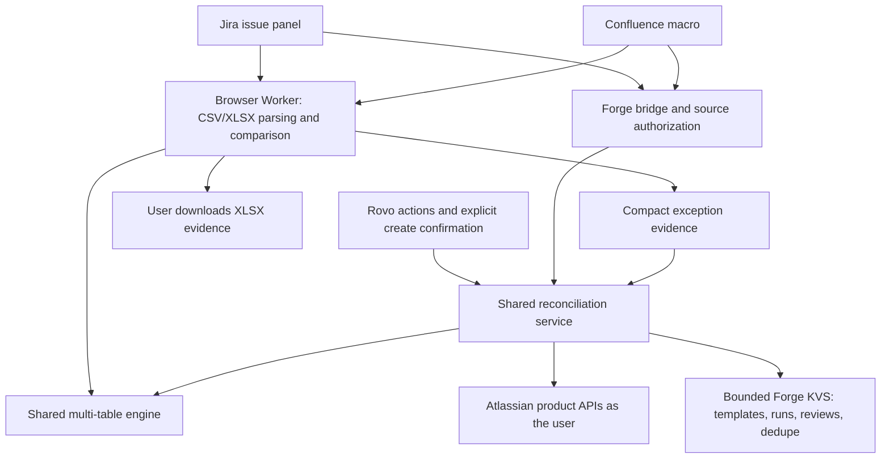

# Reconcile v3 for Jira & Confluence

Compare two to five attached CSV/XLSX exports, investigate differences and turn selected exceptions into Jira work. Reconcile runs on Atlassian Forge with a Jira issue panel, a Confluence macro and the Reconciliation Assistant in Rovo.

Development **3.10.0** adds default grouped creation in Rovo. Production remains **2.1.0** with the previously published source; this update has only been deployed to development. Forge versions are numbered independently per environment. Both Jira and Confluence are connected to the existing production installation. Forge reports Runs on Atlassian eligibility. Production distribution sharing is enabled; use the existing link in [JUDGE-INSTALL.md](JUDGE-INSTALL.md). This repository is MIT licensed; publishing source does not submit a Devpost entry or upload a video.

## Features

- Two to five tables, any reference table, composite keys, worksheet selection and CSV header detection across title/preamble rows, including Chinese headers.
- Independent numeric tolerances, accepted date formats and text normalization per comparison field. Rule passes are shown with the results.
- Optional split-payment aggregation that preserves component rows and exposes conflicting nonnumeric values as exceptions.
- Matched, mismatched, incomplete-reference, missing-reference and duplicate categories, search/filter/pagination, and explicit acceptance of possible near matches.
- Evidence-based Explained/Ignored reviews and notes. Unchanged evidence survives saved-template reload; changed evidence invalidates prior reviews.
- Reconciliation statements and XLSX export, including detailed results and optional coloured worksheets preserving original data-column and row order.
- Project/space templates, recent run history and checkbox-selected Jira issue creation, either individual or grouped, behind a separate confirmation step.
- Rovo actions for saved-template runs, explanations of stored exceptions and confirmation-gated grouped issue creation with serial retry reuse.

## What has actually been verified

All cloud acceptance data was synthetic. The source test suite passes **47/47** tests, plus **4/4** Confluence/Rovo adapter tests. Local tests cover two through five tables, rule boundaries, parsing, workbook output, authorization and changed-evidence invalidation. Five-table coverage is local, rather than a live five-table acceptance claim.

Production 2.1.0 passed a read-only Jira smoke check on an existing synthetic test issue: the three attachments returned **3 / 1 / 2 / 2 / 0**, the checked source issue fields remained unchanged, and no issue was created. The existing sharing link still displays the app, both products and the expected scopes. Production Confluence macro rendering remains unverified: the existing synthetic page contains only a development macro, and no page was changed during the read-only production check. Its successful development coverage below is separate.

On development 3.8.0, real Jira and Confluence UI runs compared three attached files containing **6 / 6 / 7** data rows. Both returned **3 matched / 1 mismatch / 2 only in reference / 2 missing from reference / 0 duplicates**. Actual downloaded workbooks were checked for ten worksheets, eight result keys and the differing amount cell's colour.

Development 3.9.0 repeated the Jira counts and fixed unstable property-order serialization in evidence identities. One explicit grouped confirmation created one test issue for selected keys 3 and 4. After a full page refresh, saved-template reload and identical rerun, the next confirmation reused that issue with no new issue. Both Explained and Ignored reviews and their notes returned; hiding reviewed exceptions reduced eight displayed rows to six. Changed amounts, row counts and rules invalidate old reviews and prevent issue reuse in local service tests. Old-version records were not migrated or claimed as migrated.

On a free Forge demo development site, the real Rovo agent ran a saved three-table template, returned a persisted run ID and the same counts, and explained the observed 300 versus 305 amount difference, delta 5. The run was independently found in the real run-history UI. After explicit confirmation, Rovo created one Jira issue for a single selected exception; a repeated request reused that same issue with zero new issues. On development 3.10.0, Rovo explicitly confirmed grouped=true for two selected exceptions, created one grouped test issue, then reused it with zero new issues on a second explicitly confirmed request.

The demo video uses real headless cloud captures with synthetic inputs. Its exported-workbook viewer is explicitly labelled LOCAL EXPORT VIEW; the v10 demo shows a real Rovo create-then-reuse recording. Unaffected Confluence footage remains identified as development 3.8.0.

## Run locally

Use Node **24.22.1** (the locked Forge CLI requires `^22.23.4 || ^24.22.1 || >=26.12.1`).

```powershell
cd app
npm ci
npm test
npm run test:adapter
npm run build
npm run preview
```

Open `http://127.0.0.1:4178/?v3`. The preview explicitly says **LOCAL PREVIEW · SYNTHETIC DATA**. Only mock mode replaces the Forge bridge, using the shared service/engine and local browser storage; production builds use the real bridge. Local mock issue IDs are synthetic. No Atlassian account is needed for preview.

Choose `ledger.csv` as A, `bank.xlsx` as B and add `invoices.csv` as C; load the sources. Select B's **Transactions** worksheet, enable **Ignore leading zeros in keys** and **Aggregate C**, then run. Expected counts are **3 / 1 / 2 / 2 / 0**. The files and exact settings are in [app/samples](app/samples) and the synthetic [examples](examples) package, including the 5.01 residual and domestic encodings. The root [samples](samples) folder retains the original 300-row two-table fixtures (270 / 18 / 10 / 10 / 1).

With preview running, `npm run test:ui` runs a headless Edge check at desktop/mobile widths, including real Worker parsing, worksheet/template reload, reviews, export and local uploads. It requires an installed Microsoft Edge browser. Outputs go to ignored `app/logs/`. `npm run check:manifest` validates the local manifest; authenticated Forge lint is `npm run lint:forge`. `npm run licenses` regenerates notices and enforces the existing license allowlist. The optional historical comparison requires your separately supplied engine through `RECONCILE_REFERENCE_FILE`; that private reference is not included.

## Install your own deployment

For the existing shared production app, follow [JUDGE-INSTALL.md](JUDGE-INSTALL.md). Jira is required; Confluence is an optional connection on the same site. The public Forge app ID in the manifest identifies the registered app and is not a credential. To deploy a separate app, register your own Forge app identity, build the UI, lint, deploy and install it with the Forge CLI. Installation needs a site administrator; reading files and creating issues still depend on the invoking user's permissions. Fresh judge-site installation and a new user's first consent flow are not claimed as verified.

## Permissions and storage

| Scope | Purpose |
| --- | --- |
| `read:jira-work` | Read source issues, attachments, JQL results and existing exception references. |
| `write:jira-work` | Create explicitly confirmed exception issues/sub-tasks. |
| `read:attachment:confluence` | Discover and download selected page attachments. |
| `read:page:confluence` | Verify page access and template space. |
| `storage:app` | Bounded templates, run summaries, compact exception/review evidence and dedupe references. |

Reconciliation data stays within Atlassian and the user’s browser: the app uses Atlassian product APIs and Forge storage, with no application-initiated external network calls.

Product requests use `api.asUser()`. The server derives the issue/page from Forge context, rechecks access and attachment membership, and rejects arbitrary source attachment IDs. Templates are shared by project/space; stored runs are only readable from their authorized source. Full workbooks are not stored in Forge KVS. Every declared scope is used by the product API or Forge KVS adapters. Removing Jira read/write and Confluence page-read scopes individually produces Forge lint errors; attachment and KVS scope use is verified by code and adapter coverage because lint does not infer those dynamic paths. The manifest has no external egress permission or remote backend; the app calls no external model endpoint. Exports are downloaded by the user. See [PRIVACY.md](PRIVACY.md) and [SUPPORT.md](SUPPORT.md).

## Architecture



Stable property-order serialization binds reviews and dedupe to unchanged rules and actual evidence. The SDK's named `makeResolver` API is preserved. The original two-table engine remains covered by regression tests.

## Known limitations

- CSV/XLSX only; UTF-8 and GBK/GB18030 CSV. Encrypted XLSX and legacy XLS are unsupported. Formulas use cached values, without recalculation. Header inference examines the first 20 rows; fix ambiguous source headers when necessary.
- Up to 50,000 rows per table and 100 XLSX columns; attached compressed files are capped at 2 MiB each, local uploads at 8 MiB. The live development Jira Worker path processed **three 50,000-row CSV tables** (150,000 input rows) in 13.884 seconds including loading, template saving and run persistence. This is the tested maximum for these narrow synthetic CSVs, not a guarantee for every workbook. A 50,001-row sheet is rejected with “Use 1–50,000 data rows per sheet; split larger exports.”
- Bridge payload safety limit: 3 MiB. The server resolver returning full rows passed three 1,000-row tables in 3.683 seconds; 5k/10k/20k per table hit the explicit 3 MiB result guard in 3.911/5.266/8.307 seconds. The normal Jira UI uses a browser Worker and only saves compact evidence, so those same sizes and 50k passed there. No Forge timeout or out-of-memory boundary was reached; those physical platform limits are not claimed as measured. JQL is capped at 5,000 issues (key/summary/status); Confluence discovery at 1,000 attachments.
- Last 20 run summaries per source, up to 200 compact exceptions per run, 180,000-byte run records, and 20 templates per project/space. Full comparison rows are transient. Grouped descriptions may truncate; retain XLSX for full evidence.
- At most 20 selected exceptions per creation request. Valid target type IDs, project permissions and required fields are necessary. Ordinary serial retries reuse references. Concurrent requests or a crash between Jira creation and KVS recording can still duplicate issues; serialize creation.
- Original-layout export preserves selected data columns/rows, rather than the source workbook's complete formatting, title preambles or unselected sheets. No FX conversion or unattended schedule is included.
- Existing pre-fix signatures are not migrated. Offline mocks do not establish real tenant permissions, quotas, consent or distribution eligibility. Concurrent creation is not claimed to be atomic.


## Live CSV capacity measurements

All values are development measurements on three identical, narrow synthetic tables, not a performance SLA. UI times include attachment loading, template saving, reconciliation and compact persistence.

| Rows per table | Jira Worker path | End-to-end seconds | Full-result server resolver |
| ---: | --- | ---: | --- |
| 1,000 | Passed | 13.209 | Passed |
| 5,000 | Passed | 10.124 | 3 MiB guard |
| 10,000 | Passed | 11.032 | 3 MiB guard |
| 20,000 | Passed | 12.096 | 3 MiB guard |
| 50,000 | Passed | 13.884 | Not measured |
| 50,001 | Friendly row-limit rejection | 45.061 | Not measured |

## License and dependencies

[MIT](LICENSE), Copyright (c) 2026 Chuzheng Xia. ExcelJS, Papa Parse and React use permissive licenses. [THIRD-PARTY-LICENSES.md](THIRD-PARTY-LICENSES.md) preserves direct/transitive notices and tooling licenses; [LICENSING-REVIEW.md](LICENSING-REVIEW.md) explains the unzipper override and optional bundler dependency. The dependency license gate remains unchanged: unknown and non-allowlisted declarations fail. Passing it is not a full security audit.
